# Meu Dinheiro

[](https://github.com/claudineinascimento/meu-dinheiro/actions/workflows/publicar.yml)
[](https://github.com/claudineinascimento/meu-dinheiro/releases/latest)
[](LICENSE)

Aplicativo de controle financeiro pessoal, simples para o dia a dia e com resultado profissional. Registra receitas, despesas fixas e variáveis, compras parceladas, empréstimos que você pegou e que fez para outras pessoas, investimentos e a reserva de emergência. Funciona no celular como app instalado (APK ou PWA), **sem internet e sem cadastro**, com PIN e digital. Os dados ficam só no seu aparelho.

Desenvolvido por **Claudinei Nascimento**.

<p>
  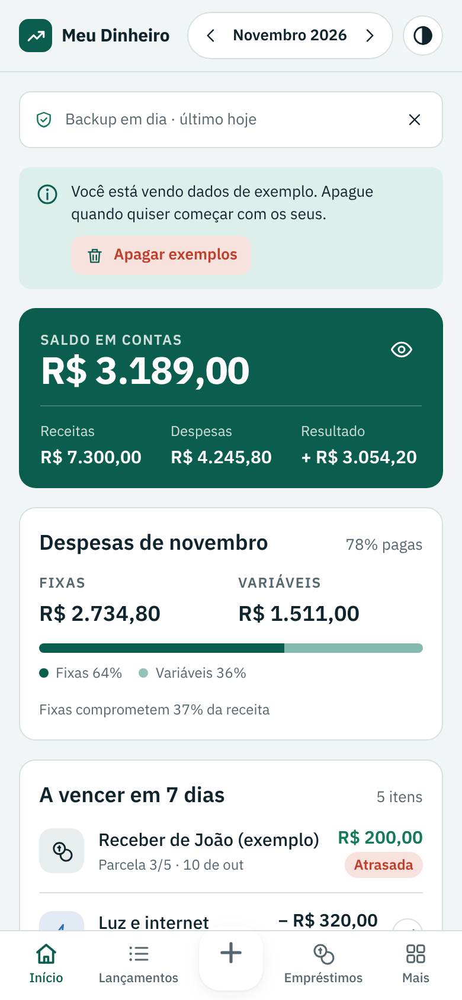
  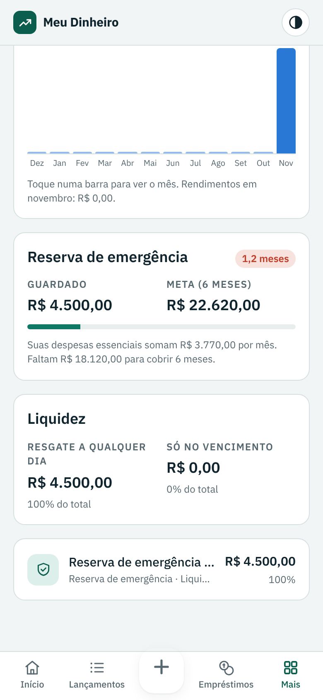
  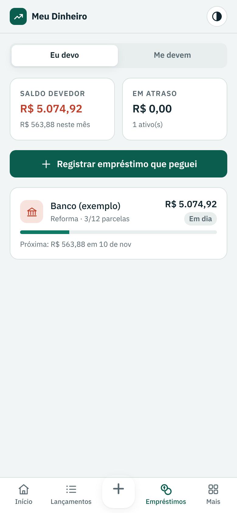
  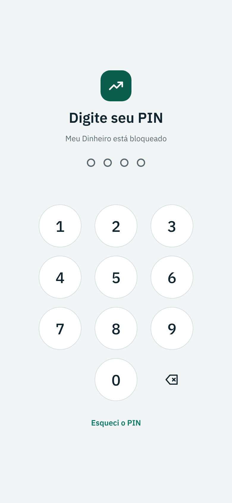
</p>

## Instalar

### Android (APK)

1. No celular, baixe **[meu-dinheiro.apk](https://github.com/claudineinascimento/meu-dinheiro/releases/latest/download/meu-dinheiro.apk)** (versão mais recente). Todas as versões ficam em [Releases](https://github.com/claudineinascimento/meu-dinheiro/releases).
2. Abra o arquivo baixado. Se o Android pedir, permita **instalar apps desta fonte** para o navegador ou o gerenciador de arquivos.
3. Toque em **Instalar** e depois em **Abrir**.

O Google Play Protect pode avisar que o app é de um desenvolvedor desconhecido, porque ele não está na Play Store. Toque em **Mais detalhes › Instalar mesmo assim**.

**Atualizar:** baixe o APK novo e instale por cima. Os dados continuam. Não desinstale antes, porque desinstalar apaga os dados do app.

Requer Android 6.0 ou mais novo.

### Android, iPhone ou computador (PWA)

Abra **[claudineinascimento.github.io/meu-dinheiro](https://claudineinascimento.github.io/meu-dinheiro/)** e instale:

| Onde | Como |
| --- | --- |
| Android (Chrome) | **Mais › Instalar o app**, ou menu **⋮ › Instalar app** |
| iPhone (Safari) | **Compartilhar › Adicionar à Tela de Início** |
| Computador (Chrome ou Edge) | Ícone de instalar na barra de endereço |

O PWA abre sem internet e se atualiza sozinho quando há conexão.

## Funcionalidades

| Área | O que faz |
| --- | --- |
| **Lançamentos** | Receitas, despesas e transferências em menos de 10 segundos, com categoria, conta, data e pago/pendente. Fixas x variáveis, **parcelamento** (divide o valor total) e **repetição mensal** (aluguel, salário, assinaturas). |
| **Início** | Saldo em contas, resultado do mês, fixas x variáveis, vencimentos dos próximos 7 dias, quem deve a quem, total investido e os maiores gastos. |
| **Contas e cartões** | Saldo de cada conta e fatura do cartão de crédito. |
| **Empréstimos** | Duas listas, *Eu devo* e *Me devem*, com parcelas, juros pela tabela Price, atrasos e saldo de cada pessoa. |
| **Investimentos** | Aportes, resgates e rendimentos, com painel: distribuição por tipo, rentabilidade, evolução em 12 meses, meta da reserva de emergência (6 meses de despesas essenciais) e liquidez. |
| **Categorias** | 29 categorias na regra 50/30/20 (essencial, estilo de vida, financeiro), editáveis. |
| **Privacidade** | Botão de **olho** que esconde o saldo e, separado, o total investido. |
| **Segurança** | PIN, digital, bloqueio automático e recuperação do PIN. Veja abaixo. |
| **Backup** | Arquivo completo, planilha (CSV), restauração e lembrete quando o backup atrasa. Veja abaixo. |
| **Tema** | Claro, escuro ou automático num único botão. |

<p>
  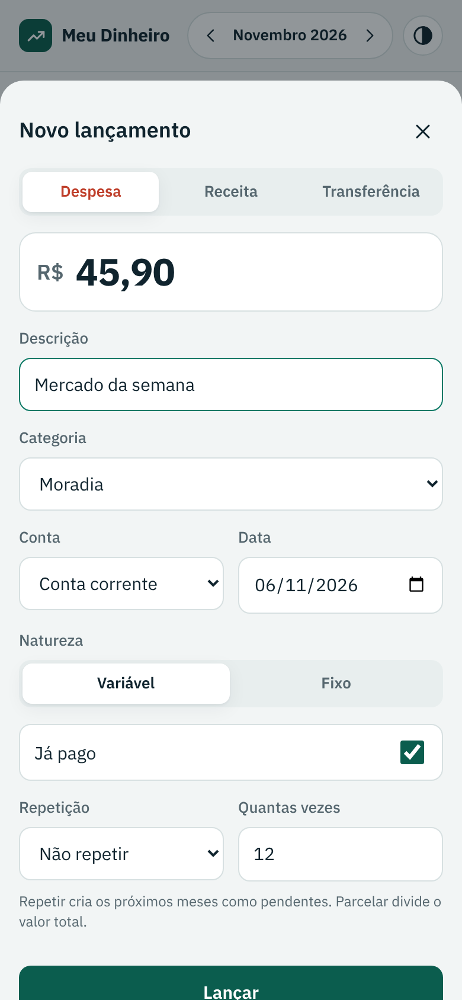
  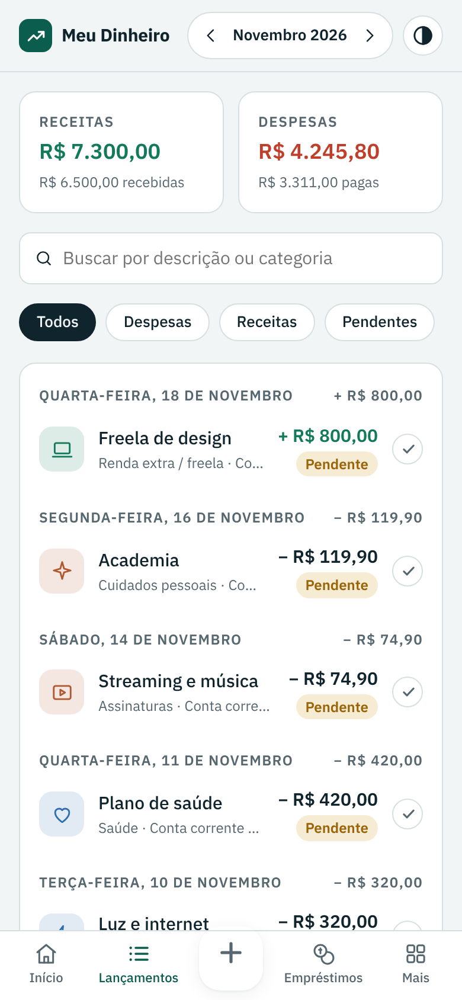
  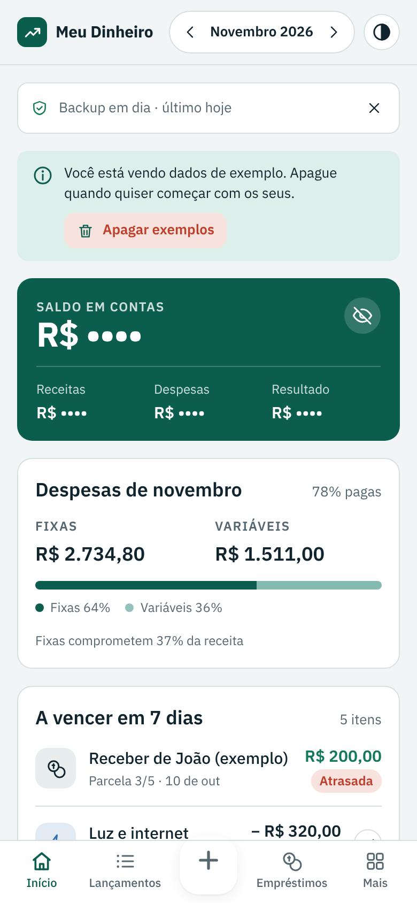
  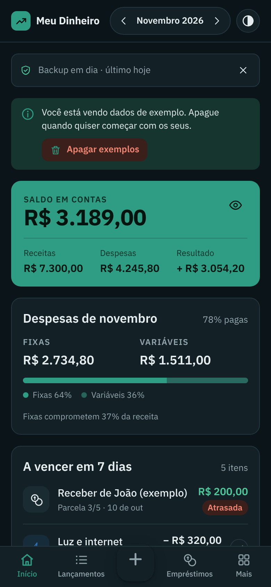
</p>

## Segurança e PIN

- **PIN** de 4 a 6 números. PINs fáceis como `1234` são recusados. O PIN não é guardado: o app guarda só um resumo PBKDF2‑SHA‑256 com 120.000 iterações e sal aleatório.
- **Digital** no Android (leitor do aparelho) e no navegador (WebAuthn).
- **Bloqueio automático** ao sair do app ou após 1, 5 ou 15 minutos sem uso. O cadeado no topo bloqueia na hora.
- **5 erros** seguidos pausam as tentativas por 30 segundos, dobrando até 15 minutos.
- **Esqueci o PIN**: ao criar o PIN, o app mostra um **código de recuperação** que aparece uma única vez. Anote fora do celular. Também dá para cadastrar uma **pergunta de segurança** e usar a **digital**. Sem nenhuma delas, a última saída é **apagar tudo** e restaurar um backup.

<p>
  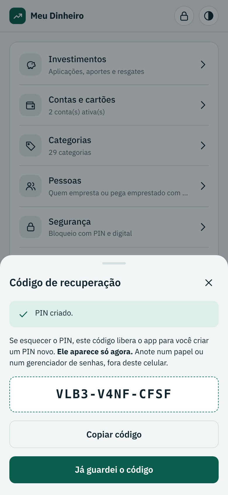
  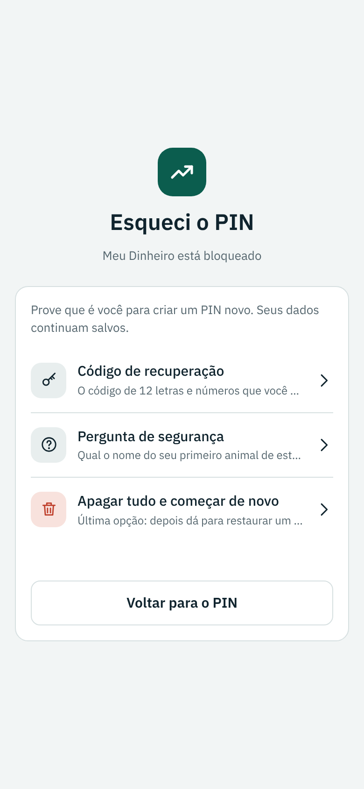
  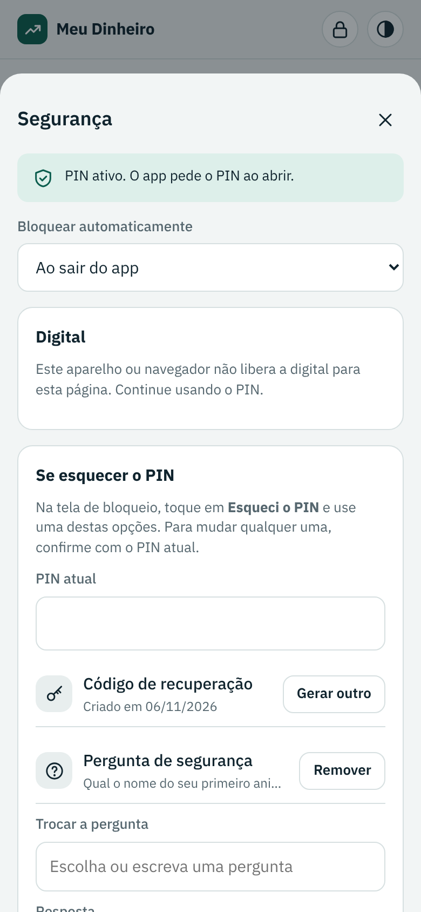
</p>

O PIN protege contra quem pega o celular já desbloqueado. Ele não substitui o bloqueio do próprio celular. Detalhes e limites em [Segurança e privacidade](docs/seguranca.md).

## Backup

Os dados ficam **só no aparelho**. Desinstalar o app ou limpar os dados do navegador apaga tudo, por isso faça backup com frequência.

- **Mais › Backup › Baixar backup completo** gera um arquivo `.json`. No APK, abre o compartilhar do Android para salvar no Google Drive, mandar por e-mail ou WhatsApp.
- **Exportar para planilha (CSV)** abre no Excel e no Google Planilhas.
- **Restaurar backup** substitui os dados atuais pelos do arquivo. Use para trocar de celular ou passar do PWA para o APK.
- A tela Início mostra a data do último backup e avisa quando ele passa do prazo (7, 15 ou 30 dias).

<p>
  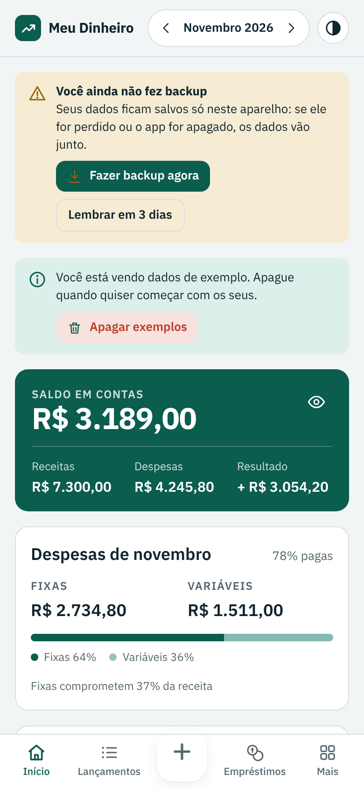
  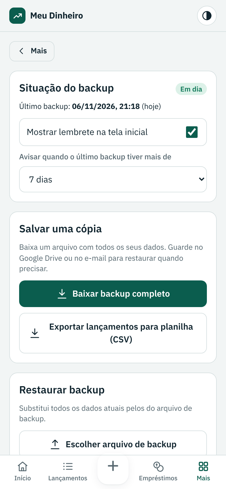
</p>

## No computador

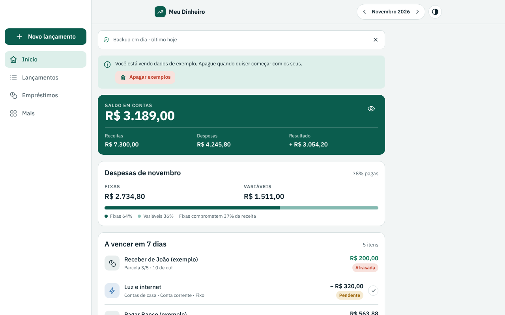

## Documentação

| Documento | Para quem | Conteúdo |
| --- | --- | --- |
| [Manual do usuário](docs/manual-do-usuario.md) | Quem usa o app | Passo a passo de todas as telas |
| [Regras financeiras](docs/regras-financeiras.md) | Quem quer entender os números | Como cada saldo, total e parcela é calculado |
| [Segurança e privacidade](docs/seguranca.md) | Todos | PIN, recuperação, digital, onde ficam os dados, limites |
| [Arquitetura](docs/arquitetura.md) | Quem mantém o código | Como o app é organizado e roda em cada plataforma |
| [Modelo de dados](docs/modelo-de-dados.md) | Quem mantém o código | Coleções, campos e formato do backup |
| [Desenvolvimento e publicação](docs/desenvolvimento.md) | Quem mantém o código | Rodar, testar, gerar o APK assinado e publicar versões |
| [Testes](docs/testes.md) | Quem mantém o código | O que os 135 testes automáticos verificam |
| [Histórico de versões](CHANGELOG.md) | Todos | O que mudou em cada versão |

## Estrutura do repositório

```
www/                    o app (index.html, manifesto, service worker, ícones)
android/                projeto Android (Capacitor 7) que empacota www/ no APK
testes/                 testes de ponta a ponta (Playwright) e o gerador de capturas
docs/                   documentação e capturas de tela (docs/img)
.github/workflows/      testa, publica o site e gera o APK assinado
```

## Desenvolvimento rápido

```bash
npm ci
npx playwright install chromium
npm test                 # 135 verificações de ponta a ponta
npm run capturas         # refaz as capturas de tela de docs/img
npx cap sync android     # copia www/ para o projeto Android
```

Cada push na `main` testa, publica o site no GitHub Pages e, quando a versão do `package.json` muda, cria um Release com o APK assinado. Pull requests geram um APK de teste. A chave de assinatura fica só nos *Secrets* do GitHub, nunca no repositório. Detalhes em [docs/desenvolvimento.md](docs/desenvolvimento.md).

## Licença

[MIT](LICENSE) © 2026 Claudinei Nascimento.
