# Manual do usuário

Este manual mostra como usar cada tela do Meu Dinheiro. O app tem cinco áreas na barra inferior: **Início**, **Lançamentos**, **+** (novo lançamento), **Empréstimos** e **Mais**. No computador, a barra vira um menu lateral.

## 1. Primeiros passos

1. Instale o app (veja o [README](../README.md#instalar)).
2. Em **Mais › Contas e cartões**, ajuste as contas. O app já cria *Conta corrente* e *Carteira*. Informe em cada uma o saldo de hoje e, se quiser, banco, agência, conta e chave Pix. Cadastre seus cartões de crédito com a fatura em aberto, o limite e os dias de fechamento e vencimento.
3. Em **Mais › Segurança**, crie um PIN, **anote o código de recuperação** fora do celular e ative a digital. Com a digital ativa, você não precisa digitar o PIN no dia a dia.
4. Toque em **+** e faça o primeiro lançamento.
5. Em **Mais › Backup**, faça o primeiro backup. O app avisa na tela Início quando o backup atrasa.

### Atualizar o app

- **APK**: baixe o `meu-dinheiro.apk` da versão nova e abra o arquivo. O Android instala por cima e **os dados continuam**. Não desinstale antes, porque desinstalar apaga os dados do app.
- **PWA (site instalado)**: atualiza sozinho. Com internet, o app sempre abre a versão mais nova; sem internet, abre a última que guardou.

Quer ver o app funcionando antes? Na tela Início, toque em **Ver exemplo**. Os dados de exemplo saem com **Apagar exemplos**.

## 2. Início

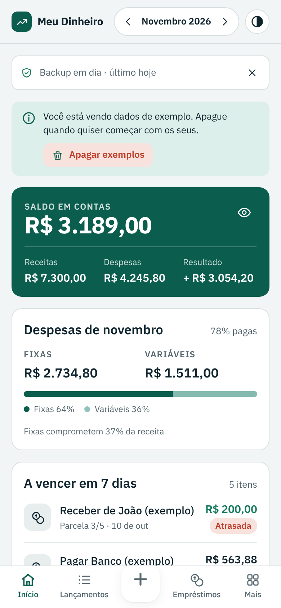 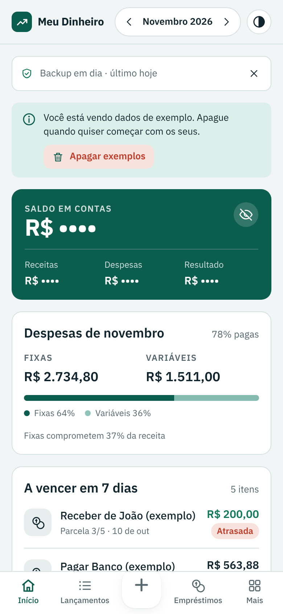 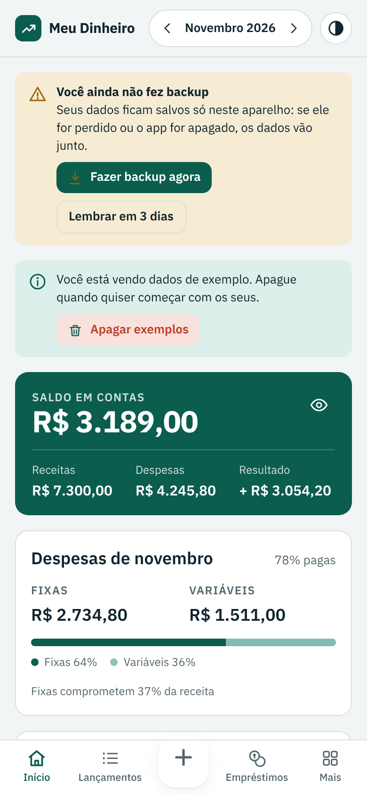

| Bloco | O que mostra |
| --- | --- |
| Aviso de backup | Quando foi o último backup. Fica amarelo se passar do prazo (7 dias por padrão). Toque no **×** ou em **Lembrar em 3 dias** para esconder. |
| Saldo em contas | Soma dos saldos de todas as contas ativas, contando só o que já foi pago ou recebido. O **olho** esconde o saldo e os totais do mês. |
| Receitas, Despesas, Resultado | Totais do mês escolhido no topo, pagos e pendentes. Resultado = receitas − despesas. |
| Despesas do mês | Fixas x variáveis, quanto já foi pago e quanto as fixas comprometem da receita. |
| A vencer em 7 dias | Lançamentos pendentes e parcelas de empréstimo que vencem até 7 dias à frente, incluindo os atrasados. |
| Eu devo / Me devem | Saldo em aberto dos empréstimos e quanto está atrasado. |
| Investido | Total aplicado em investimentos e os rendimentos. Tem o seu próprio **olho** para esconder o valor. |
| Maiores gastos do mês | As 5 categorias com mais despesa. |

Use as setas **‹ ›** no topo para trocar de mês.

O olho fica salvo no aparelho: se você esconder o saldo, ele continua escondido ao abrir o app de novo, até tocar no olho outra vez. O saldo das contas em **Mais › Contas e cartões** segue o olho do saldo; a tela de Investimentos segue o olho do investido.

## 3. Lançar uma receita ou despesa

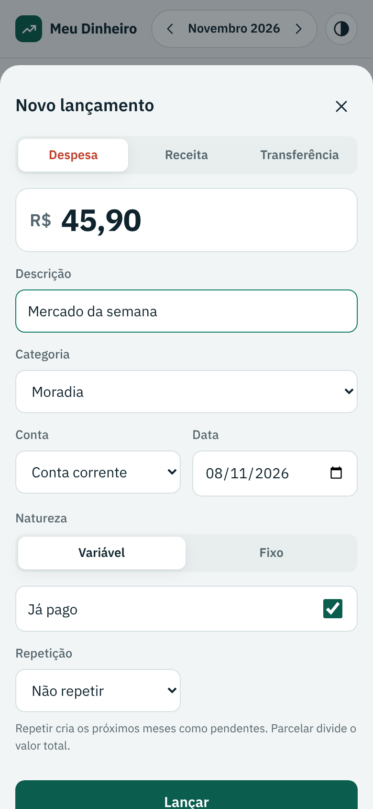

1. Toque em **+**.
2. Escolha **Despesa**, **Receita** ou **Transferência**.
3. Digite o valor. Vale `45,90`, `3.500` ou `1.234,56`.
4. Escolha a categoria e a conta. A data já vem com o dia de hoje.
5. Em despesas, marque **Fixo** para gastos que se repetem todo mês.
6. Deixe **Já pago** marcado se o dinheiro já saiu da conta. Desmarque para contas a vencer.
7. Toque em **Lançar**.

### Repetir e parcelar

No campo **Repetição**:

- **Repetir todo mês**: cria o mesmo valor nos próximos meses, como pendente. Use para aluguel, salário, academia e assinaturas.
- **Parcelar o valor**: divide o valor total em parcelas mensais. Exemplo: R$ 600 em 3 vezes viram 3 lançamentos de R$ 200 marcados *1/3*, *2/3* e *3/3*.

Ao excluir um lançamento de uma série, o app pergunta se exclui só ele ou ele e os próximos.

O campo **Quantas vezes** aparece quando você escolhe repetir ou parcelar.

### Transferência

Move dinheiro entre suas contas sem contar como receita nem despesa. Use também para **pagar a fatura do cartão**: abra o cartão em **Mais › Contas e cartões** e toque em **Pagar fatura**, que já preenche a transferência com o valor da fatura.

## 4. Lançamentos

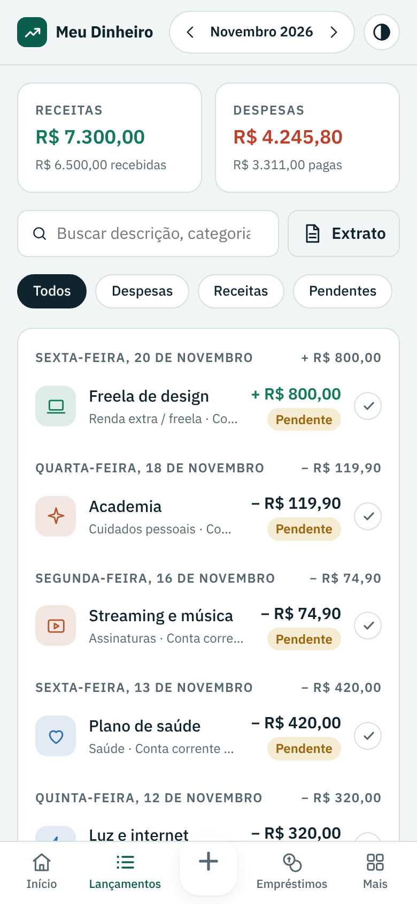

- A lista mostra o mês escolhido, agrupada por dia, com o saldo de cada dia.
- **Filtros**: Todos, Despesas, Receitas, Pendentes, Fixos, Transferências.
- **Busca** por descrição, categoria, conta ou valor.
- **Extrato**: gera o extrato em PDF ou planilha. Veja abaixo.
- O **círculo** à direita marca como pago ou pendente com um toque.
- Toque no lançamento para editar ou excluir.

Lançamentos criados por um empréstimo ou investimento aparecem com uma etiqueta e só são alterados pela tela de origem. Assim as parcelas e os saldos não se desencontram.

### Extrato em PDF

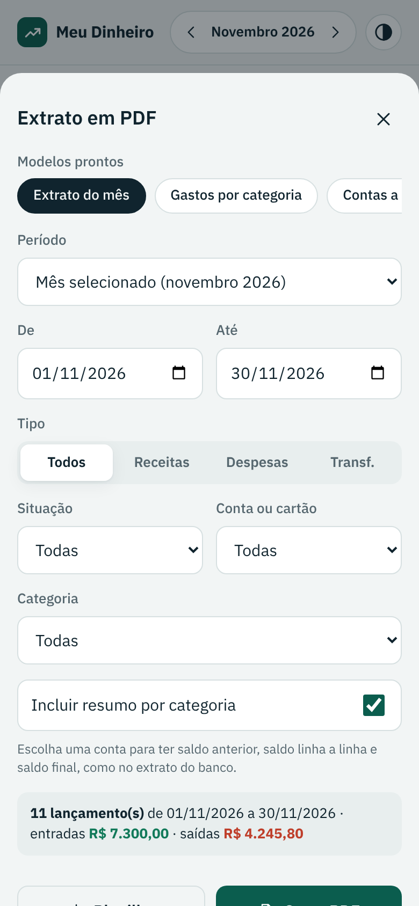 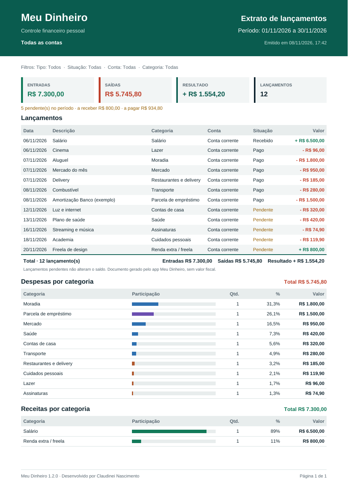

Na tela **Lançamentos**, toque em **Extrato**.

| Modelo pronto | O que gera | Para quê |
| --- | --- | --- |
| Extrato do mês | Tudo do mês escolhido no topo, com resumo por categoria | Fechar o mês, conferir com o banco |
| Gastos por categoria | Só despesas do mês, com o peso de cada categoria | Ver onde cortar |
| Contas a pagar (30 dias) | Despesas pendentes de hoje até 30 dias | Planejar os pagamentos |
| Rendimentos para o IR | Receitas recebidas no ano passado | Declaração do Imposto de Renda |
| Fatura do cartão | Lançamentos do mês no cartão | Conferir a fatura antes de pagar |

Ou monte o seu filtro:

- **Período**: mês selecionado, mês anterior, últimos 3, 6 ou 12 meses, este ano, ano passado ou datas livres.
- **Tipo**: todos, receitas, despesas ou transferências.
- **Situação**: todas, só pagos e recebidos, ou só pendentes.
- **Conta ou cartão**: com uma conta escolhida, o PDF traz **saldo anterior**, **saldo linha a linha** e **saldo final**, como o extrato do banco.
- **Categoria** e **resumo por categoria**.

A prévia mostra quantos lançamentos entram e os totais antes de gerar. **Gerar PDF** cria um arquivo A4 com cabeçalho, filtros, resumo, tabela com subtotais por mês, totais e número das páginas. **Planilha** gera o mesmo filtro em CSV. No APK, o arquivo abre o compartilhar do Android (Drive, e-mail, WhatsApp).

## 5. Empréstimos

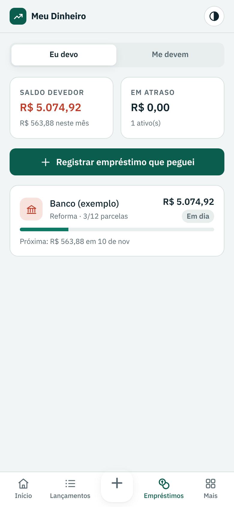 

O app separa duas listas:

- **Eu devo**: empréstimos, financiamentos e parcelamentos que você pegou com banco ou pessoa.
- **Me devem**: dinheiro que você emprestou para alguém.

### Registrar um empréstimo

1. Escolha a aba e toque em **Registrar empréstimo**.
2. Informe com quem é, o valor, o número de parcelas e, se houver, os **juros ao mês**.
3. O app calcula a parcela pela tabela Price. Você pode corrigir o valor se o contrato for diferente.
4. Escolha o primeiro vencimento e a conta.
5. Deixe marcado **Registrar a entrada (ou saída) do dinheiro na conta** para o saldo da conta refletir o empréstimo.

### Pagar ou receber parcelas

Abra o empréstimo e toque em **Pagar** (ou **Receber**) na parcela. Confira valor, data e conta e toque em **Confirmar**. O app cria o lançamento e baixa o saldo devedor. Tocou errado? Toque no círculo verde da parcela para desfazer.

### Pagar um valor extra ou quitar antes

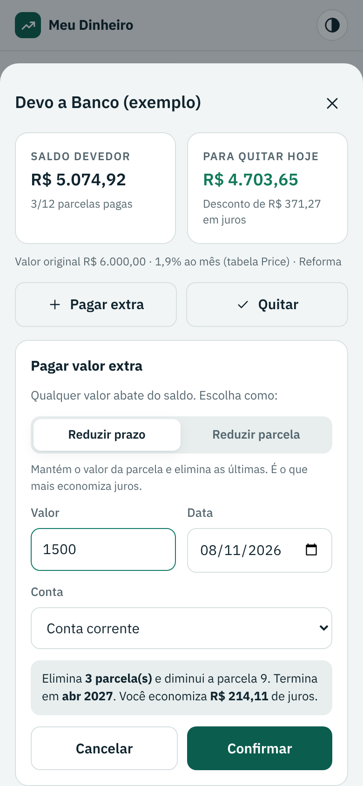

O topo do empréstimo mostra o **saldo devedor** (soma das parcelas em aberto) e quanto custa **quitar hoje**, já sem os juros do tempo que falta.

- **Pagar extra** (ou **Receber extra**, em *Me devem*): digite qualquer valor e escolha:
  - **Reduzir prazo**: mantém o valor da parcela e elimina as últimas. É o que mais economiza juros.
  - **Reduzir parcela**: mantém o número de parcelas e diminui o valor de cada uma, aliviando o mês.
- **Quitar**: paga todas as parcelas em aberto de uma vez, com desconto dos juros.

Antes de confirmar, o app mostra o efeito: quantas parcelas somem, a parcela nova, quando o empréstimo termina e quanto você economiza. Ao confirmar, ele cria um lançamento com o valor pago e marca as parcelas antecipadas. Errou? Em **Pagamentos extras**, toque em **Desfazer** no último. Num empréstimo sem juros, como com um amigo, o valor extra abate direto do saldo. As fórmulas estão em [Regras financeiras](regras-financeiras.md#pagamento-extra-e-quitação-antecipada).

Parcelas vencidas e não pagas ficam marcadas como **Atrasada**. Em **Mais › Pessoas**, cada pessoa mostra quanto te deve e quanto você deve a ela.

## 6. Investimentos

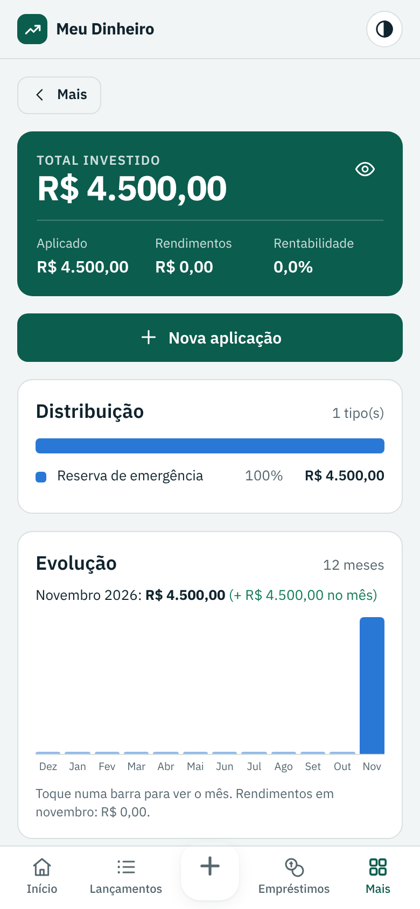 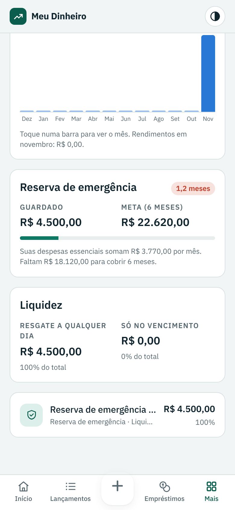

Em **Mais › Investimentos**:

1. Toque em **Nova aplicação** e informe nome, tipo, instituição e liquidez. Se já existe dinheiro aplicado, informe o saldo de hoje.
2. Abra a aplicação para registrar:
   - **Aporte**: sai da conta e entra no investimento.
   - **Resgate**: sai do investimento e volta para a conta.
   - **Rendimento**: aumenta o saldo do investimento.

Aportes não contam como gasto do mês. É dinheiro guardado. O resgate não pode ser maior que o saldo da aplicação. Para mudar nome, tipo, instituição ou liquidez, abra a aplicação e toque em **Editar dados**.

### Painel de investimentos

| Bloco | O que mostra |
| --- | --- |
| Total investido | Saldo de todas as aplicações, o valor aplicado (saldo inicial + aportes − resgates), os rendimentos e a rentabilidade (rendimentos ÷ total aplicado). |
| Distribuição | Quanto do total está em cada tipo (reserva, renda fixa, Tesouro, ações...), em barra e lista com percentuais. |
| Evolução | Saldo investido no fim de cada um dos últimos 12 meses. Toque numa barra para ver o valor e a variação do mês. |
| Reserva de emergência | Compara as aplicações do tipo *Reserva de emergência* com 6 meses das suas despesas essenciais (média dos últimos 3 meses). |
| Liquidez | Quanto dá para resgatar a qualquer dia e quanto só no vencimento. |
| Lista | Cada aplicação com saldo, peso no total e rendimentos. |

## 7. Contas, cartões, categorias e pessoas

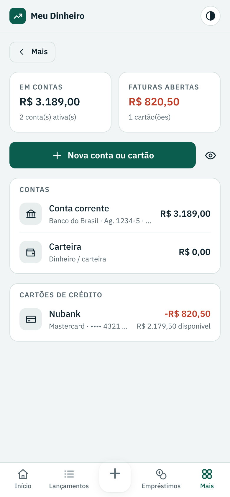 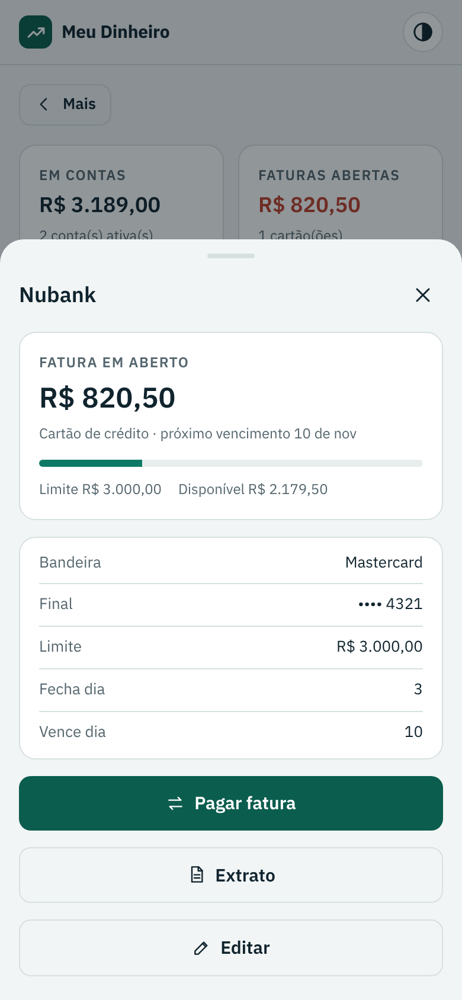

Em **Mais › Contas e cartões**, o topo mostra quanto há nas contas e quanto há em faturas abertas. Toque numa conta para ver os dados e as ações.

| Tipo | Dados que dá para guardar | Ações |
| --- | --- | --- |
| Conta corrente e poupança | Banco, agência, número da conta, titular, chave Pix (CPF, CNPJ, e-mail, telefone ou aleatória), observações | **Copiar dados** (para mandar a alguém), **Extrato** da conta, **Editar** |
| Cartão de crédito | Banco emissor, bandeira, **4 últimos números**, limite, dia de fechamento, dia de vencimento, conta que paga a fatura | Fatura em aberto, limite disponível, próximo vencimento, **Pagar fatura**, **Extrato**, **Editar** |
| Dinheiro / carteira | Saldo e observações | **Extrato**, **Editar** |

No cartão, informe a **fatura em aberto** como um valor positivo: o app guarda como dívida. Por segurança, **não guarde senhas, o número completo do cartão nem o código de segurança (CVV)**: o app aceita só os 4 últimos números.

| Tela | O que dá para fazer |
| --- | --- |
| Contas e cartões | Criar, editar dados, ajustar saldo inicial, arquivar (desmarcar *Conta ativa*). Uma conta com lançamentos ou empréstimos não pode ser excluída, só arquivada. |
| Categorias | Criar, renomear, trocar ícone, ocultar. As categorias marcadas *Usada pelo app* são necessárias para empréstimos e investimentos e não podem ser ocultadas. |
| Pessoas | Nome, telefone e observação. São criadas sozinhas ao registrar um empréstimo. |

## 8. Segurança

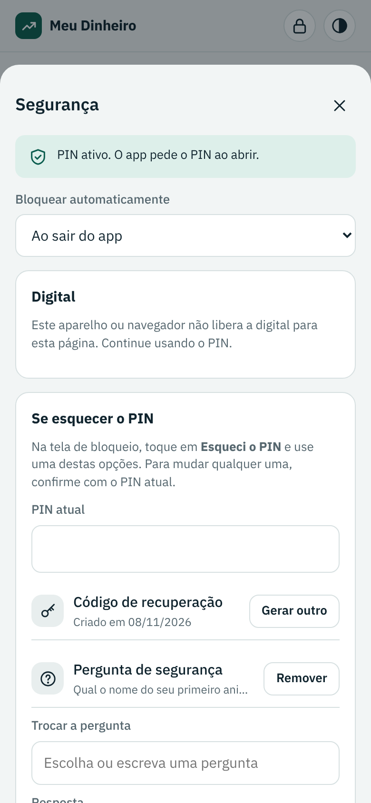 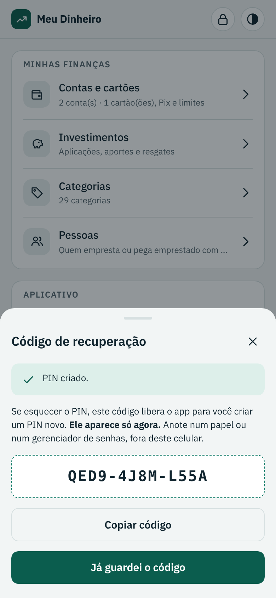 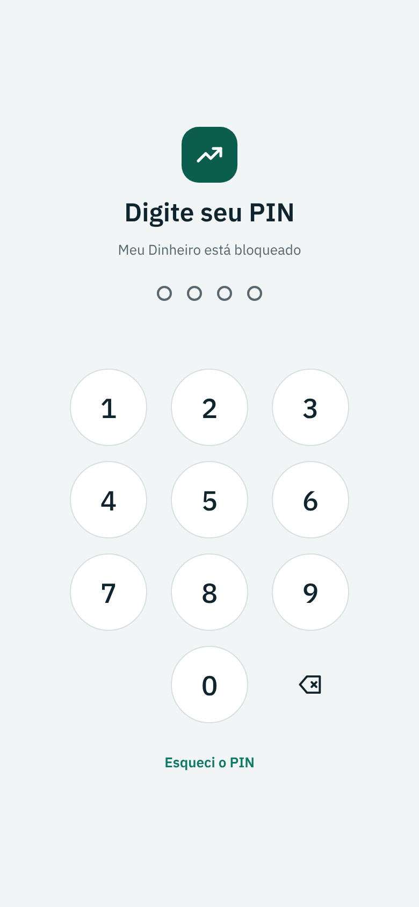

Em **Mais › Segurança**:

- **Criar PIN**: de 4 a 6 números. O app recusa PINs fáceis como `1234` e `0000`.
- **Digital**: toque em **Ativar digital neste aparelho**. Cada aparelho ativa a sua. Com a digital ativa, o app pede a digital **sozinho** ao abrir e ao voltar para o app, no APK e no PWA: basta encostar o dedo, sem PIN. Se a digital falhar, digite o PIN. Quando você bloqueia pelo cadeado, o app espera você tocar em **Entrar com a digital**. Dá para desligar o pedido automático em **Pedir a digital assim que o app abrir**.
- **Bloquear automaticamente**: ao sair do app, ou após 1, 5 ou 15 minutos sem uso.
- **Cadeado no topo**: bloqueia na hora.
- **Alterar PIN**, **Tirar o PIN**, ativar a digital e mudar a recuperação pedem o PIN atual.
- **Se esquecer o PIN**: ao criar o PIN, o app mostra um **código de recuperação** de 12 letras e números (ex.: `3R9U-VPGH-QX4M`). Anote fora do celular: ele aparece só uma vez. Você também pode cadastrar uma **pergunta de segurança**. Dá para gerar outro código quando quiser.

Após 5 PINs errados, o app pausa as tentativas por 30 segundos. A pausa dobra a cada erro seguinte, até 15 minutos.

Esqueceu o PIN? Na tela de bloqueio, toque em **Esqueci o PIN** e escolha uma opção:

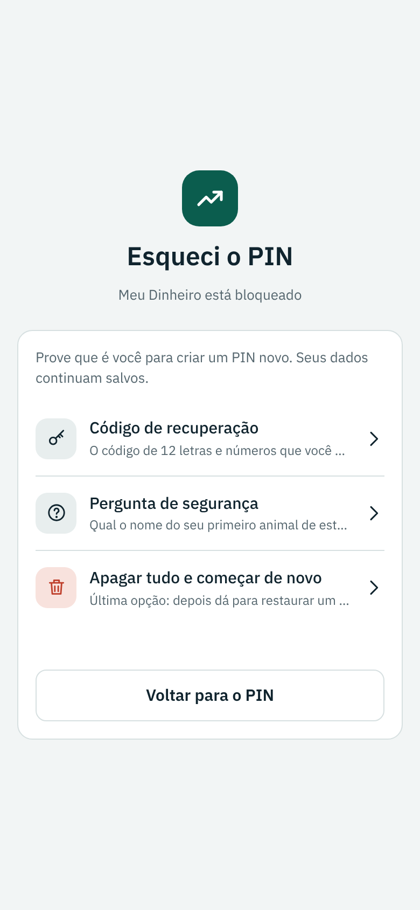

| Opção | O que acontece |
| --- | --- |
| Usar a digital | Se a digital estiver ativa no aparelho, confirme e crie um PIN novo. |
| Código de recuperação | Digite o código guardado (maiúsculas, traços e espaços não importam) e crie um PIN novo. O código usado é trocado por outro. |
| Pergunta de segurança | Responda (acentos e maiúsculas não importam) e crie um PIN novo. |
| Apagar tudo e começar de novo | Última opção: digite `APAGAR`. Todos os dados e o PIN são apagados. Depois, restaure um backup em **Mais › Backup**. |

Erros no código ou na resposta contam como PIN errado e também levam à pausa. Detalhes em [Segurança e privacidade](seguranca.md).

### Restaurar padrão de fábrica

Em **Mais › Restaurar padrão de fábrica**, o app apaga todos os dados e configurações e volta como recém-instalado: lançamentos, contas, cartões, empréstimos, investimentos, pessoas, categorias alteradas, PIN, digital, código e pergunta de recuperação, tema, olho e lembrete de backup. Para confirmar, digite o **seu PIN** (sem PIN, digite `RESTAURAR`). PIN errado conta nas tentativas e leva à mesma pausa. Use **Fazer backup antes** se quiser guardar uma cópia.

## 9. Backup, planilha e troca de celular

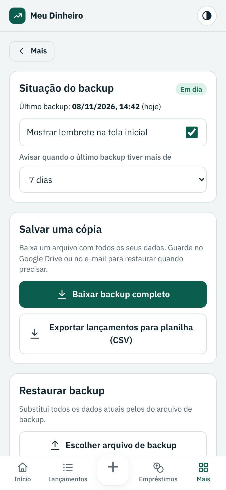

Em **Mais › Backup e exportação**:

- **Baixar backup completo**: gera um arquivo `.json` com todos os dados. No APK, abre o menu de compartilhar do Android para salvar no Google Drive, enviar por e-mail ou WhatsApp.
- **Exportar lançamentos para planilha (CSV)**: abre no Excel ou no Google Planilhas, separado por ponto e vírgula.
- **Restaurar backup**: substitui todos os dados atuais pelos do arquivo.
- **Situação do backup**: data e hora do último backup feito neste aparelho. Ligue ou desligue o lembrete na tela inicial e escolha o prazo do aviso: 7, 15 ou 30 dias.

Para trocar de celular ou de versão do app: baixe o backup no aparelho antigo e use **Restaurar backup** no novo.

## 10. Sobre e ajuda

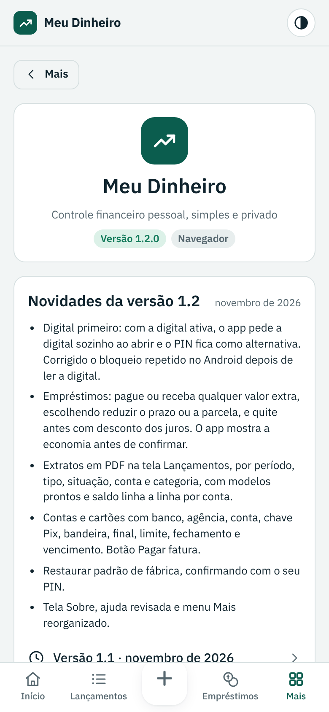

- **Mais › Ajuda**: perguntas e respostas de cada tela.
- **Mais › Sobre**: versão instalada, onde o app está rodando (APK, PWA, navegador ou Claude), novidades da versão e das anteriores, links para baixar versões novas e para o código-fonte, e a assinatura *Desenvolvido por Claudinei Nascimento*.

## 11. Tema

O botão no canto superior direito alterna entre **automático** (segue o celular), **claro** e **escuro**. Também dá para escolher em **Mais › Tema**.

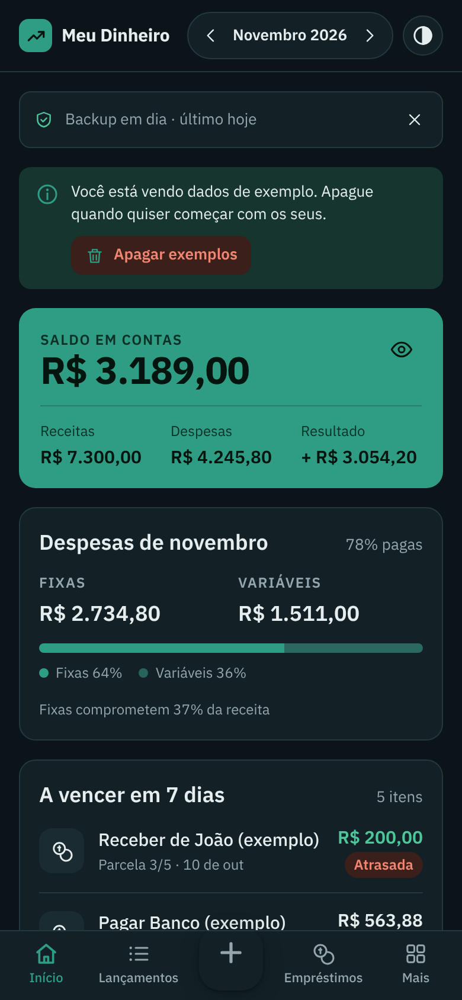

## Perguntas frequentes

**O saldo não bate com o banco.** Confira se o saldo inicial da conta está certo e se os lançamentos já debitados estão marcados como pagos. Só lançamentos pagos mexem no saldo.

**Por que o empréstimo que peguei não aparece como receita?** O dinheiro emprestado não é renda. Ele entra no saldo da conta, mas não no resultado do mês. As parcelas que você paga contam como despesa financeira.

**Perdi o celular.** Instale o app no novo aparelho e restaure o último backup. Por isso vale fazer backup toda semana.
