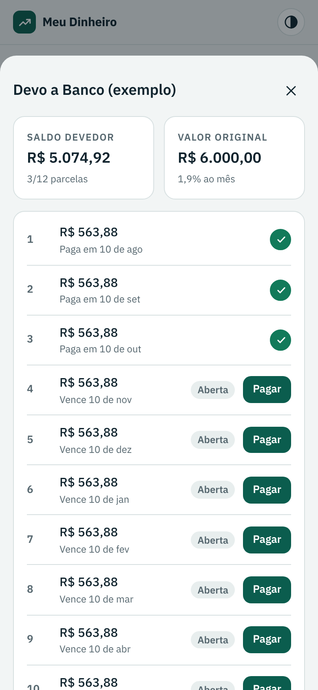

# Manual do usuário

Este manual mostra como usar cada tela do Meu Dinheiro. O app tem cinco áreas na barra inferior: **Início**, **Lançamentos**, **+** (novo lançamento), **Empréstimos** e **Mais**. No computador, a barra vira um menu lateral.

## 1. Primeiros passos

1. Instale o app (veja o [README](../README.md#instalar)).
2. Em **Mais › Contas e cartões**, ajuste as contas. O app já cria *Conta corrente* e *Carteira*. Informe em cada uma o saldo de hoje. Num cartão de crédito, informe a fatura atual como número negativo, por exemplo `-350,00`.
3. Em **Mais › Segurança**, crie um PIN e, se quiser, ative a digital.
4. Toque em **+** e faça o primeiro lançamento.

Quer ver o app funcionando antes? Na tela Início, toque em **Ver exemplo**. Os dados de exemplo saem com **Apagar exemplos**.

## 2. Início

| Bloco | O que mostra |
| --- | --- |
| Saldo em contas | Soma dos saldos de todas as contas ativas, contando só o que já foi pago ou recebido. |
| Receitas, Despesas, Resultado | Totais do mês escolhido no topo, pagos e pendentes. Resultado = receitas − despesas. |
| Despesas do mês | Fixas x variáveis, quanto já foi pago e quanto as fixas comprometem da receita. |
| A vencer em 7 dias | Lançamentos pendentes e parcelas de empréstimo que vencem até 7 dias à frente, incluindo os atrasados. |
| Eu devo / Me devem | Saldo em aberto dos empréstimos e quanto está atrasado. |
| Investido | Total aplicado em investimentos. |
| Maiores gastos do mês | As 5 categorias com mais despesa. |

Use as setas **‹ ›** no topo para trocar de mês.

## 3. Lançar uma receita ou despesa

1. Toque em **+**.
2. Escolha **Despesa**, **Receita** ou **Transferência**.
3. Digite o valor. Vale `45,90`, `3.500` ou `1.234,56`.
4. Escolha a categoria e a conta. A data já vem com o dia de hoje.
5. Em despesas, marque **Fixo** para gastos que se repetem todo mês.
6. Deixe **Já pago** marcado se o dinheiro já saiu da conta. Desmarque para contas a vencer.
7. Toque em **Lançar**.

### Repetir e parcelar

No campo **Repetição**:

- **Repetir todo mês**: cria o mesmo valor nos próximos meses, como pendente. Use para aluguel, salário, academia e assinaturas.
- **Parcelar o valor**: divide o valor total em parcelas mensais. Exemplo: R$ 600 em 3 vezes viram 3 lançamentos de R$ 200 marcados *1/3*, *2/3* e *3/3*.

Ao excluir um lançamento de uma série, o app pergunta se exclui só ele ou ele e os próximos.

### Transferência

Move dinheiro entre suas contas sem contar como receita nem despesa. Use também para **pagar a fatura do cartão**: transfira da conta corrente para o cartão.

## 4. Lançamentos

- A lista mostra o mês escolhido, agrupada por dia, com o saldo de cada dia.
- **Filtros**: Todos, Despesas, Receitas, Pendentes, Fixos, Transferências.
- **Busca** por descrição ou categoria.
- O **círculo** à direita marca como pago ou pendente com um toque.
- Toque no lançamento para editar ou excluir.

Lançamentos criados por um empréstimo ou investimento aparecem com uma etiqueta e só são alterados pela tela de origem. Assim as parcelas e os saldos não se desencontram.

## 5. Empréstimos

 

O app separa duas listas:

- **Eu devo**: empréstimos, financiamentos e parcelamentos que você pegou com banco ou pessoa.
- **Me devem**: dinheiro que você emprestou para alguém.

### Registrar um empréstimo

1. Escolha a aba e toque em **Registrar empréstimo**.
2. Informe com quem é, o valor, o número de parcelas e, se houver, os **juros ao mês**.
3. O app calcula a parcela pela tabela Price. Você pode corrigir o valor se o contrato for diferente.
4. Escolha o primeiro vencimento e a conta.
5. Deixe marcado **Registrar a entrada (ou saída) do dinheiro na conta** para o saldo da conta refletir o empréstimo.

### Pagar ou receber parcelas

Abra o empréstimo e toque em **Pagar** (ou **Receber**) na parcela. Confira valor, data e conta e toque em **Confirmar**. O app cria o lançamento e baixa o saldo devedor. Tocou errado? Toque no círculo verde da parcela para desfazer.

Parcelas vencidas e não pagas ficam marcadas como **Atrasada**. Em **Mais › Pessoas**, cada pessoa mostra quanto te deve e quanto você deve a ela.

## 6. Investimentos

Em **Mais › Investimentos**:

1. Toque em **Nova aplicação** e informe nome, tipo, instituição e liquidez. Se já existe dinheiro aplicado, informe o saldo de hoje.
2. Abra a aplicação para registrar:
   - **Aporte**: sai da conta e entra no investimento.
   - **Resgate**: sai do investimento e volta para a conta.
   - **Rendimento**: aumenta o saldo do investimento.

Aportes não contam como gasto do mês. É dinheiro guardado.

## 7. Contas, categorias e pessoas

| Tela | O que dá para fazer |
| --- | --- |
| Contas e cartões | Criar, renomear, ajustar saldo inicial, arquivar (desmarcar *Conta ativa*). Uma conta com lançamentos não pode ser excluída, só arquivada. |
| Categorias | Criar, renomear, trocar ícone, ocultar. As categorias marcadas *Usada pelo app* são necessárias para empréstimos e investimentos e não podem ser ocultadas. |
| Pessoas | Nome, telefone e observação. São criadas sozinhas ao registrar um empréstimo. |

## 8. Segurança

Em **Mais › Segurança**:

- **Criar PIN**: de 4 a 6 números. O app recusa PINs fáceis como `1234` e `0000`.
- **Digital**: toque em **Ativar digital neste aparelho**. Cada aparelho ativa a sua. No APK, a digital é pedida sozinha ao abrir o app.
- **Bloquear automaticamente**: ao sair do app, ou após 1, 5 ou 15 minutos sem uso.
- **Cadeado no topo**: bloqueia na hora.
- **Alterar PIN** e **Tirar o PIN** pedem o PIN atual.

Após 5 PINs errados, o app pausa as tentativas por 30 segundos. A pausa dobra a cada erro seguinte, até 15 minutos.

Esqueceu o PIN? Na tela de bloqueio, toque em **Esqueci o PIN** e digite `REDEFINIR`. O PIN e a digital são removidos e seus dados continuam salvos. Detalhes em [Segurança e privacidade](seguranca.md).

## 9. Backup, planilha e troca de celular

Em **Mais › Backup e exportação**:

- **Baixar backup completo**: gera um arquivo `.json` com todos os dados. No APK, abre o menu de compartilhar do Android para salvar no Google Drive, enviar por e-mail ou WhatsApp.
- **Exportar lançamentos para planilha (CSV)**: abre no Excel ou no Google Planilhas, separado por ponto e vírgula.
- **Restaurar backup**: substitui todos os dados atuais pelos do arquivo.

Para trocar de celular ou de versão do app: baixe o backup no aparelho antigo e use **Restaurar backup** no novo.

## 10. Tema

O botão no canto superior direito alterna entre **automático** (segue o celular), **claro** e **escuro**. Também dá para escolher em **Mais › Tema**.

## Perguntas frequentes

**O saldo não bate com o banco.** Confira se o saldo inicial da conta está certo e se os lançamentos já debitados estão marcados como pagos. Só lançamentos pagos mexem no saldo.

**Por que o empréstimo que peguei não aparece como receita?** O dinheiro emprestado não é renda. Ele entra no saldo da conta, mas não no resultado do mês. As parcelas que você paga contam como despesa financeira.

**Perdi o celular.** Instale o app no novo aparelho e restaure o último backup. Por isso vale fazer backup toda semana.
