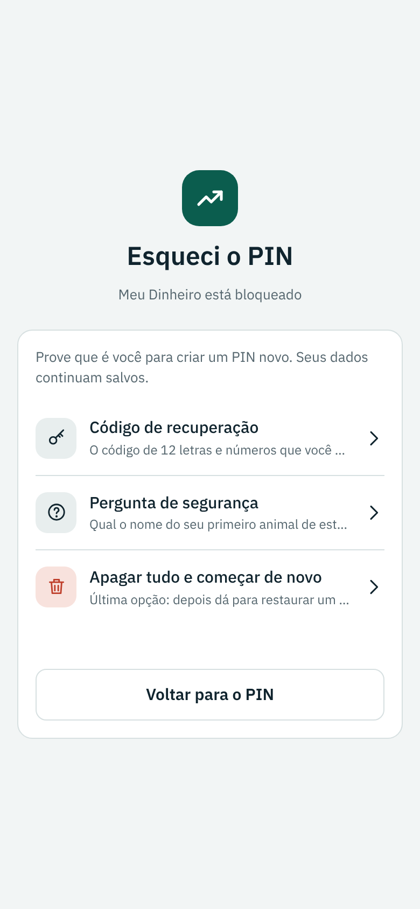
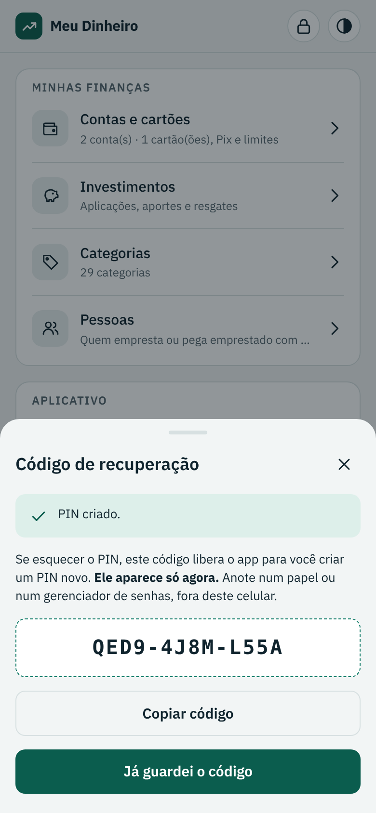

# Segurança e privacidade

## Onde ficam os dados

| Versão | Onde os dados ficam | Quem acessa |
| --- | --- | --- |
| APK (Android) | Armazenamento interno do app no celular | Só o app |
| PWA (site instalado) | Armazenamento do navegador no aparelho | Só o app, naquele navegador |
| Versão no Claude | Banco de dados da página, na área privada da sua conta | Só você, com seu login |

O app **não envia dados para nenhum servidor** nas versões APK e PWA. A única conexão externa é para baixar a fonte de letras (Google Fonts) na primeira abertura. Sem internet, o app usa a fonte do sistema.

Como os dados ficam no aparelho, **o backup é sua responsabilidade**. Desinstalar o app ou limpar os dados do navegador apaga tudo. No Android, o backup automático do Google pode incluir os dados do app quando estiver ativado no celular, mas não conte só com ele.

## PIN

- De 4 a 6 números. PINs fáceis (todos iguais ou em sequência, como `1234` e `9876`) são recusados.
- O PIN **não é guardado**. O app guarda só um resumo criptográfico: PBKDF2 com SHA‑256, 120.000 iterações e um sal aleatório por PIN. Quem copiar os dados não lê o PIN.
- Após 5 erros seguidos, o app pausa as tentativas por 30 segundos, dobrando a cada novo erro até 15 minutos.
- **Bloqueio automático**: ao sair do app (padrão) ou após 1, 5 ou 15 minutos sem uso. O cadeado no topo bloqueia na hora.
- Enquanto bloqueado, o conteúdo fica coberto, inacessível ao toque e ao teclado, e os valores nem são desenhados na página.
- Compartilhar o backup ou o extrato, escolher um arquivo para restaurar ou ler a digital tiram o app da frente por instantes. Voltar em até 2 minutos depois dessas ações não bloqueia o app; voltar depois disso bloqueia normalmente.
- Depois de desbloquear com a digital, a **primeira** volta ao app nos 3 segundos seguintes não bloqueia. No Android, o leitor de digital abre uma tela do sistema por cima do app; até a versão 1.1, ao fechar essa tela o app achava que você tinha saído, bloqueava de novo e pedia a digital outra vez, sem parar.
- Ativar a digital, mudar a recuperação, alterar ou tirar o PIN pedem o PIN atual. Assim, quem pega o app aberto por um instante não consegue cadastrar a própria digital ou trocar a pergunta.

## Digital

| Versão | Como funciona |
| --- | --- |
| APK | Usa o leitor do Android (BiometricPrompt) pelo plugin `@aparajita/capacitor-biometric-auth`. É pedida sozinha ao abrir o app. |
| PWA | Usa o leitor do aparelho pelo padrão WebAuthn, com verificação do usuário obrigatória. |
| Versão no Claude | Depende do navegador liberar o WebAuthn dentro da página. Se não liberar, o app avisa e você usa o PIN. |

A digital é ativada **por aparelho** e fica registrada só nele. O PIN continua valendo como alternativa.

**Digital ou PIN.** Com a digital ativa, o app pede a digital sozinho ao abrir e ao voltar para o app (APK e PWA). Você entra só com a digital, sem digitar o PIN. O PIN fica como reserva: é pedido se a digital falhar, se você cancelar a leitura ou para trocar configurações de segurança. Ele continua obrigatório para ativar a digital, porque a digital do aparelho pode ser de outra pessoa (quem cadastrou a digital no celular). Quando você bloqueia pelo cadeado, a digital não é pedida sozinha. O pedido automático pode ser desligado em **Mais › Segurança › Pedir a digital assim que o app abrir**.

No navegador, alguns aparelhos só abrem a leitura depois de um toque. Nesse caso, toque em **Entrar com a digital**.

## Esqueci o PIN

 

Até a versão 1.0, *Esqueci o PIN* tirava o PIN só com a palavra `REDEFINIR`, o que deixava qualquer pessoa entrar. Agora é preciso provar quem é:

| Forma | Como é guardada | Observação |
| --- | --- | --- |
| Código de recuperação | Só o resumo PBKDF2 (120.000 iterações, sal próprio). O código aparece uma única vez, ao criar o PIN ou ao gerar outro. | 12 caracteres sem letras parecidas (sem 0/O, 1/I), cerca de 60 bits. Depois de usado, o app gera outro. |
| Pergunta de segurança | A pergunta em texto; a resposta só como resumo PBKDF2 da resposta sem acentos e em minúsculas. | Escolha uma resposta difícil de adivinhar. É a opção mais fraca das três. |
| Digital | Registro no próprio aparelho. | Só vale onde foi ativada. |
| Apagar tudo | Nada é revelado: os dados e o PIN são apagados. | Depois, restaure um backup. |

Erros no código e na resposta contam nas mesmas tentativas do PIN, com a mesma pausa. Ao recuperar, o app pede um PIN novo; a pergunta e o código continuam valendo (o código é trocado se foi ele o usado).

## O que o PIN protege, e o que não protege

O PIN protege contra quem pega o celular **já desbloqueado** e abre o app: um curioso, um filho, alguém no trabalho. Ele não substitui a segurança do próprio celular. Quem tiver acesso técnico ao armazenamento do aparelho (ferramentas de desenvolvedor, root) consegue ler os dados, porque eles não são criptografados no aparelho.

Para proteção forte:

1. Use bloqueio de tela no celular (senha, digital ou rosto).
2. Mantenha o celular atualizado.
3. Guarde os arquivos de backup em local protegido. Eles contêm todos os seus dados financeiros, sem criptografia.

## Restaurar padrão de fábrica

Em **Mais › Restaurar padrão de fábrica**, o app apaga dados, PIN, digital, recuperação e preferências deste aparelho (ou da sua conta, na versão no Claude). Com PIN, a confirmação é o **próprio PIN**: quem pega o celular desbloqueado não consegue zerar o app. PIN errado conta nas mesmas tentativas e pausas. Sem PIN, é preciso digitar `RESTAURAR`. Os arquivos de backup que você já salvou não são apagados.

## Dados de contas e cartões

O app guarda banco, agência, número da conta, titular e chave Pix para você consultar e copiar. Do cartão, guarda só bandeira, os **4 últimos números**, limite e datas. **Nunca guarde senhas, o número completo do cartão nem o código de segurança (CVV)**: esses dados ficam sem criptografia no aparelho e no arquivo de backup.

## Extrato em PDF

O PDF é gerado no próprio aparelho, sem enviar nada para servidor. Ele contém seus lançamentos e, com uma conta escolhida, banco, agência e número da conta: guarde e compartilhe com o mesmo cuidado do backup.

## Ocultar valores

O botão de **olho** esconde o saldo (Início e Contas) e, separadamente, o total investido (Início e Investimentos), trocando os valores por `R$ ••••`. A escolha fica salva no aparelho. Serve para abrir o app perto de outras pessoas; não é uma proteção como o PIN.

## Lembrete de backup

O app guarda neste aparelho a data e a hora do último backup completo que deu certo. Na tela Início, mostra *Backup em dia* ou um aviso quando passa do prazo (7, 15 ou 30 dias, escolhido em **Mais › Backup**). O aviso pode ser adiado por 3 dias, escondido até o próximo prazo ou desligado.

## Assinatura do APK

O APK é assinado com uma chave própria do app. Ela garante que só versões geradas por este projeto instalam por cima da versão atual. A chave fica fora do repositório, nos segredos do GitHub `KEYSTORE_BASE64` e `KEYSTORE_PASSWORD`, com uma cópia guardada pelo dono do projeto. Perder a chave obriga a desinstalar o app (depois de fazer backup) para instalar uma nova versão.

- O `.gitignore` bloqueia `*.keystore`, `*.jks` e `KEYSTORE_*.txt`, para a chave não ir parar no repositório por engano.
- No GitHub Actions, a chave é montada só durante a compilação, a senha é mascarada nos logs e o passo confere se a senha abre a chave antes de compilar.
- Pull requests de *forks* não recebem os segredos e não geram APK assinado.
- Cada Release traz `meu-dinheiro.apk.sha256` para conferir se o arquivo baixado é o original.
- Baixe o APK só da página de [Releases](https://github.com/claudineinascimento/meu-dinheiro/releases) deste repositório.

## Permissões do APK

O APK não pede acesso a contatos, localização, câmera ou arquivos. Usa só internet (fontes), biometria e o menu de compartilhar do Android.
